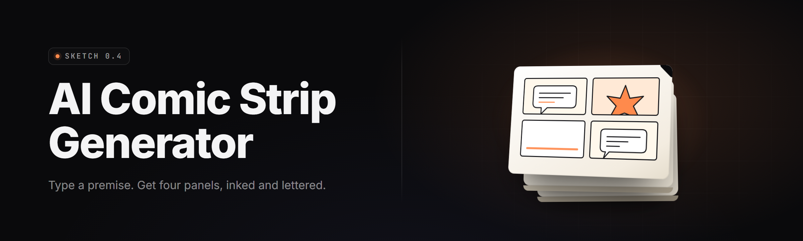

  
  
  

  

  
  

---

**Desktop panel-to-page engine: story beats in, inked strips out — 36 modules deep.**

I built this because laying out a comic is 80% mechanical drudgery and 20% the part you actually wanted to do. This is the 80% done for you. Runs as a single portable Windows binary, no runtime to install, no accounts, everything local unless you point it at a remote endpoint.

---

## 🧭 Table of Contents

- [Overview](#-overview)
- [What is a Comic Beat, Really](#-what-is-a-comic-beat-really)
- [The Problem](#-the-problem)
- [The Solution](#-the-solution)
- [Quick Start](#-quick-start)
- 

  

(#-download)
- [Key Features](#-key-features)
- [Panel Generation Modules](#-panel-generation-modules)
- [Lettering & Balloon Modules](#-lettering--balloon-modules)
- [Continuity & Consistency Modules](#-continuity--consistency-modules)
- [Export & Finishing Modules](#-export--finishing-modules)
- [Usage Guidelines](#-usage-guidelines)
- [Comparison](#-comparison)
- [System Requirements](#-system-requirements)
- [Installation](#-installation)
- [Known Issues](#-known-issues)
- [Tips for Best Results](#-tips-for-best-results)
- [FAQ](#-faq)
- [Changelog — v2.4](#-changelog--v24)

---

## 📖 Overview

| Category | Details |
| --- | --- |
| Product name | AI Comic Strip Generator — Pro |
| Release | v2.4.x, 2026 |
| Distribution | Portable `.exe` (no installer, no admin by default) |
| Engine | Local diffusion backend + optional remote API |
| Model stack | SDXL base, Flux dev, per-character LoRA adapters |
| Script input | Plain text beats, Fountain, Final Draft, CSV |
| Page targets | 3-panel daily, 4-panel Sunday, 6-panel webtoon, custom grid |
| Export | PNG, JPG, WebP, layered PSD, PDF booklet, CBZ |
| License | MIT (open core, per-project presets shareable) |

This is a comic production pipeline, not a text-to-image toy. You give it beats or a full script; it derives shot framing, generates each panel with consistent characters and locations, layers balloons and SFX to the correct reading order, and hands back a page you can ink over or ship as-is. Every stage is exposed as a module so you can swap in your own model, your own lettering font, your own grid template.

The panel engine and the continuity engine talk to each other through a project file. That's what keeps Character B's scar on the same cheek across twelve strips without you re-describing it every time.

---

## 🗯️ What is a Comic Beat, Really

| Term | Explanation |
| --- | --- |
| Beat | One unit of "something changes" — the atom of your script. |
| Panel | One framed image; the visual container a beat lands in. |
| Shot | Camera logic for a panel: wide / medium / close / OTS / Dutch. |
| Balloon | The text bubble; has a position, tail anchor, and reading-order slot. |
| Speaker anchor | Which character a balloon's tail points at, resolved per panel. |
| Continuity token | Persistent identity tag (face, outfit, prop) reused across panels. |
| Gutter | The space between panels; carries implied time. |
| Page lock | Rigid grid mode where panel geometry stops adapting to content. |

Useful because a comic reads through rhythm — wide to close to wide again. The tool exposes beat → shot mapping directly so you control the cadence instead of accepting whatever the model felt like drawing.

- Beats map to panels 1:1 by default, or split across 2 with a split cue.
- Shot auto-derives from beat intensity (action beats favor wider, reaction beats closer).
- Gutters and page locks are explicit toggles, not hidden defaults.
- Speaker anchors resolve from named dialogue, not run order.
- Continuity tokens survive across sessions in the project file, `.cstrip`.

---

## 🔧 The Problem

- Existing text-to-image tools draw one gorgeous panel and forget who the character was by panel two.
- Laying out a grid in Photoshop means dragging shapes for an hour before any drawing starts.
- Lettering balloon placement is a manual, error-prone slog that breaks reading order on bilingual pages.
- Re-typing physical descriptors every prompt burns the whole prompt budget.
- No comic tool understands *sequence* — they see "a panel," not "a beat in a beat in a beat."
- Inking consistency across a twelve-strip run is basically a second job.
- Exports come out as separate images; assembling a CBZ or a webtoon strip is hand work afterward.

---

## ✅ The Solution

| Problem | Solution |
| --- | --- |
| Characters drift between panels | Continuity tokens pin face, outfit, prop via LoRA + reference attention |
| Layout takes forever | Grid templates apply in one click; auto-grid derives from beat count |
| Balloon order breaks | Reading-order engine places balloons tail-anchor to speaker, top-left to bottom-right |
| Re-typing descriptors | Saved character sheets inject into every beat prompt |
| Tools don't understand sequence | Beat-graph engine models 12 strips as a chain, not 12 images |
| Inking inconsistency | Style Locks freeze line weight, hatching density, palette per universe |
| Exports are separate files | Native CBZ, layered PSD, and webtoon-strip exporters load in one step |

---

## ⚡ Quick Start

1. 🎬 **Download** the portable `.exe` from the project landing page and extract to a folder you own.
2. 📁 **Create a project** — File → New → pick grid (3-panel / 4-panel / webtoon).
3. 📝 **Paste your beats or fountain script** into the script pane; tag speakers with `@Name`.
4. 🧬 **Define characters** in the character sheet; give each one a continuity token.
5. 🖼️ **Generate page 1** — the engine frames, draws, letters, and lays out in one pass.
6. 🛠️ **Ink over or export** — layered PSD for hand touch-ups, CBZ for publication.

---

## 

  

## 🧩 Key Features

| Feature | Description | Benefit |
| --- | --- | --- |
| Beat-graph engine | Models your script as a directed sequence of state changes | Preserves rhythm across a whole issue |
| Continuity tokens | Persistent identity tags per character, prop, location | Faces and outfits stop drifting |
| Grid templates | 20 built-in grids + custom SVG grid import | Layout in zero clicks after first setup |
| Reading-order letterer | Balloon tail-anchor + Z-order-aware placement | Bilingual pages keep correct order |
| Style Locks | Freeze line weight, hatch density, palette | Consistent inking across a run |
| LoRA manager | Load, stack, weight blenders, per-character adapters | Your characters, not the base model |
| Fountain / FDX import | Parse industry scripts into beats | No re-typing script format |
| Batch mode | Generate 50 pages headless from CLI | Whole issue without babysitting |
| Layered PSD export | Panels on separate layers, balloons separate | Hand touch-up stays clean |
| CBZ / webtoon strip export | Directly publishable containers | No post-assembly |
| Speech-strip preview | Vertical scroll view of a webtoon run | Check pacing as readers see it |
| Local + remote backends | Local SDXL/Flux, or point at an API | Privacy option or speed option |

---

## 🎨 Panel Generation Modules

**Framing**
- **Shot Planner** — maps each beat to a shot (wide / medium / close / OTS / Dutch).
- **Beat Splitter** — breaks one beat across two panels with a split cue.
- **Establishing Beats** — auto-inserts a wide establishing shot when a new location enters.
- **Reaction Cut** — generates the reaction-shot partner when dialogue follows an action.
- **Panel Packer** — density rebalancer: crowds or relaxes panels depending on text load.

**Drawing**
- **Continuous Inker** — maintains line weight per Style Lock across panels.
- **Hatch Brush** — density-controlled hatching pass over shadow areas.
- **Palette Freezer** — palette quantization against a universe-defined swatch chart.
- **Background Reuse** — reuses a generated location plate across panels in the same room.
- **Prop Anchor** — pins a prop (gun, mug, katana) to a character's hand across a beat.
- **Weather Pass** — applies rain / snow / dust as a separate layer.
- **Lighting Presets** — three-point / chiaroscuro / comedy three-tone / noir sole-source.

---

## 💬 Lettering & Balloon Modules

**Balloons**
- **Balloon Shaper** — speech / thought / whisper / radio-rectangle / off-panel-tail-tapered.
- **Tail Anchorer** — attaches a tail to the resolved speaker's mouth region.
- **Order Engine** — places balloons top-left → bottom-right, respects interruption stacks.
- **Text Fitter** — wraps and letter-spaces to fit the shaped balloon without overflow.
- **Font Library** — hand-lettered fonts bundled + drop-in custom TTF/OTF.

**SFX and Captions**
- **SFX Inker** — stamps onomatopoeia with optional hand-distortion.
- **Caption Boxer** — narration captions with chrome (yellow box, transparent, stencil).
- **Whisper Balloon** — dotted outline for low-volume dialogue.
- **Translation Row** — bilingual caption row under a balloon for shipping localized strips.

---

## 🧬 Continuity & Consistency Modules

- **Character Sheet** — face, hair, marks, outfit, body type, reference images.
- **Token Reuse Engine** — injects the token reference into every prompt featuring that character.
- **Outfit Changer** — swaps clothes while preserving face; tracks costume changes by scene.
- **Location Ledger** — reuses a plate for a room across panels, with noise variance to avoid clone-look.
- **Prop Ledger** — persists ownership and current hand position of recurring objects.
- **Timeline Ledger** — tracks day / time-of-day per panel; warns on obvious contradictions.
- **Wound Tracker** — bleed / bruise / missing-gear persistence across panels per event.
- **Prop-Return Warning** — flags a prop that "left scene one but appears again later with no re-entry cue."

---

## 📦 Export & Finishing Modules

- **PSD Layered Exporter** — panels, balloons, SFX, captions on separate layers.
- **CBZ Builder** — sequence across a volume into a publisher-accepted container.
- **Webtoon Strip** — vertical slice with gutters sized for scroll reading.
- **PDF Booklet** — imposition-ready PDF for 4-panel / Sunday runs.
- **Print Bleed Check** — verifies trim, gutter, safe area before export.
- **Watermark Pad** — user-applied, off-by-default, per-project mark.
- **Metadata Stuffer** — comic title, creators, issue number embedded in every export.
- **Preset Share** — pack a project's grids, Locks, and character sheets as a shareable preset.

---

## 📐 Usage Guidelines

**Allowed**
- Personal and commercial comics — the tool produces art you own.
- Recipe/project presets you share with your team.
- Posting panels and strips you generated under any platform's terms.
- Batch-mode scripts checked into your own CI for comic release pipelines.

**Not allowed**
- Redistribution of bundled LoRA adapters as your own model releases.
- Rebranding and reselling the binary while stripping the license.
- Feeding a scraped-art dataset into the LoRA trainer for redistribution.
- Using brand-name characters in a commercial export without rights.
- Bypassing the continuity ledger to publish contradicted continuity as if it's the tool's fault.

---

## 🥊 Comparison

| Aspect | Alternative | This Tool |
| --- | --- | --- |
| Character consistency across panels | Manual per-panel prompts | Continuity tokens + reference attention |
| Grid layout | Manual shape-dragging in Photoshop | Template + auto-grid |
| Balloon placement | By hand, all pages | Reading-order engine, tail-anchored |
| Script ingestion | Copy-paste into individual prompts | Direct Fountain / FDX import |
| Sequence awareness | None — image-by-image | Beat-graph engine, whole run aware |
| Consistency of inking | Style "in your head" | Style Locks frozen per universe |
| Export path | Separate image files, then assemble | Native CBZ / PSD / webtoon in one click |
| Batch mode | Usually SaaS-only | Headless CLI, portable |

---

## 🖥️ System Requirements

| Component | Minimum | Recommended |
| --- | --- | --- |
| OS | Windows 10 21H2 x64 | Windows 11 23H2 x64 |
| CPU | 4 cores / 8 threads | 8 cores / 16 threads |
| RAM | 16 GB | 32 GB |
| GPU (local mode) | 8 GB VRAM, CUDA 12 | 16 GB+ VRAM, RTX 4070+ class |
| Disk | 12 GB free (models) | 60 GB NVMe (SDXL + Flux + LoRAs) |
| Runtime | None (portable) | Optional CUDA runtime from same drive |
| Network (remote mode) | — | Stable connection to endpoint |
| Input | Mouse | Pen tablet recommended for touch-up |

---

## 📥 Installation

1. **Extract.** Grab the portable build from the project page and extract into a folder you own — avoid `Program Files` and system dirs so the tool can write its cache and LoRA folder next to the binary.
   - The extraction folder becomes your working project root; keep it on an SSD if you plan multi-page runs.
   - If SmartScreen fires a first-run prompt, that's Windows' default unsigned-app behavior; details → run anyway.

2. **First launch setup.** On the first run the tool writes a `config.toml`, a `models/` folder, and a `presets/` folder.
   - Drop any SDXL/Flux checkpoints you already have into `models/base/`.
   - Character LoRAs go into `models/lora/<character-slug>/`.
   - If you're in remote mode, add the endpoint URL and key in `Settings → Remote Backend`.

3. **Verify a panel.** Open the sample project `samples/daily-3panel.cstrip`, hit Generate page 1, and confirm a strip lands.
   - If it fails, check `logs/startup.log` — missing CUDA runtime and missing base model are the two common hits.
   - Confirm the panel pipeline end-to-end before starting a real project; it saves an hour of head-scratching later.

---

## 🧪 Known Issues

| Issue | Fix |
| --- | --- |
| First-run Generation stalls at "loading base model" on cold installs | Let it finish the first model load without clicking around; subsequent loads are cached and fast. |
| Bilingual translation row overlaps dialogue balloons on dense pages | Enable `Fit → Translation Row → Stack` to force a second baseline under the primary text. |
| Chapter-import from FDX loses panel breaks on dual-column scripts | Re-export from the source app as Fountain, or flip FDX import to `loose` mode in import settings. |
| Webtoon export crops the bottom margin on ultra-long runs | Set `Strip Max Length` to `auto`; >8000 px strips hit some image decoders' limits. |
| Character sheet face lock drifts after a costume change on some LoRA sets | Set costume LoRA weight to `0.6` and pin face LoRA to `1.0`. |
| Voice-over / SFX row lands before its scene's SFX balloon | Open Lettering → Order Engine → `Sound rows after SFX balloon` — enable, then reflow page. |

---

## 🎯 Tips for Best Results

- Write beats as **one state change per line** — 15 words is a good average, 25 is the ceiling before the panel dissolves.
- Give every recurring character a **full character sheet** with at least **3 reference images** before generating anything.
- Turn on **Establishing Beats** for any multi-room story; it saves you from six panel-1s that all look like the same hallway.
- Use the LF (Letterer's Format) dialogue convention — `@Speaker: line text` — so anchors resolve cleanly.
- Keep **Style Locks** for line weight and hatching frozen across a universe; only unlock for deliberate flashback / dream sequences.
- Reuse location plates for hallway shots, but bump `Plate Noise` to `0.15` to avoid clone-look adjacency.
- Batch mode in groups of 8–12 pages; the pipeline's context window for continuity favors grouped runs.
- Save a shareable preset **per universe** — grids, Locks, character sheets — so you can hand a co-creator the whole project skeleton.

---

## ❔ FAQ

**Q:** Do I need an internet connection?
**A:** Only if you set Remote Backend. Local mode — SDXL and Flux running on your own GPU — runs fully offline after the first model download.

**Q:** Will my characters really stay consistent across a full issue?
**A:** Yes, within the limits of the model. Continuity tokens pin face, marks, and outfit via LoRA plus reference attention. Costume changes, injuries, and prop position are tracked by ledgers. Obvious model-level drift (identical twins hallucinated as the same face) is on you to separate with distinct refs.

**Q:** Does it work without a GPU?
**A:** It runs on CPU, but slowly. Remote Backend mode is better if you don't have CUDA-class hardware; your station just handles framing, lettering, and export.

**Q:** Can I export layered PSDs?
**A:** Yes — panels, balloons, SFX, and captions each land on their own layer group with editable text. That's the intended round-trip: generate, export PSD, ink in Photoshop/Procreate, re-import, done.

**Q:** Can I publish what I make commercially?
**A:** The tool output is yours. Commercial rights depend on the licenses of the base model and any LoRAs you use. Read those.

**Q:** What about Fountain vs Final Draft?
**A:** Fountain imports cleanly. Final Draft (FDX) imports with occasional panel-break fixes needed — see Known Issues. If you write prose, the beat parser handles plain text, parseable by line breaks.

**Q:** Are there cloud accounts or usage limits?
**A:** No account, no quota. Local mode has zero metering. Remote Backend mode bills at whatever your endpoint charges.

**Q:** Where do project files live?
**A:** Everything in your extraction folder. `.cstrip` files are self-contained — grids, character sheets, LoRAs by reference, and settings. Move the folder, keep the project.

**Q:** Does batch mode need an interactive session?
**A:** No. Headless CLI accepts a `.cstrip`, a `--steps` count, and `--out` folder, generates 50 pages across the run, and exits. Suitable for a scheduled CI job.

**Q:** Can I hand-author panels and import them?
**A:** Yes — File → Import → Panel Images lets you drop your own drawings into the layout as if the pipeline made them, and the letterer still does reading-order balloons on top.

**Q:** Is there an SDK or plugin API?
**A:** The exporter and letterer are scriptable from the built-in Text Transform language. A full SDK is on the roadmap for 2027; the current build is CLI + GUI.

---

## 📒 Changelog — v2.4

- v2.4.2 — Wound Tracker persistence fix across scene boundary re-imports.
- v2.4.1 — Webtoon strip export no longer crops the final panel's bottom margin.
- v2.4.0 — Beat Splitter, Whisper Balloon, and per-universe Preset Share added; 20 new grid templates.
- v2.3.4 — CBZ builder packs multi-issue projects correctly on case-sensitive filesystems.

---

Comics are rhythm and consistency, held together by beats — and most tools out there only solve one drawing at a time. This one tries the harder problem: twelve strips that belong to the same universe. Local, portable, no account, exports in every format a publisher will actually accept. Cook on it, ink over it, publish it.

absolute potato to you, Sam. The fridge door's open whenever you're ready for the next build.
